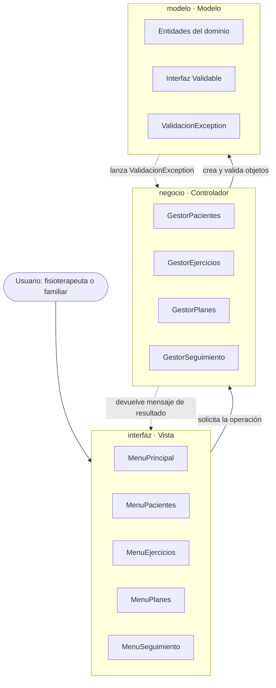
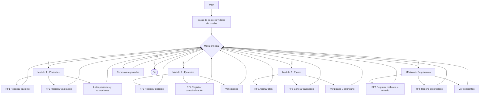
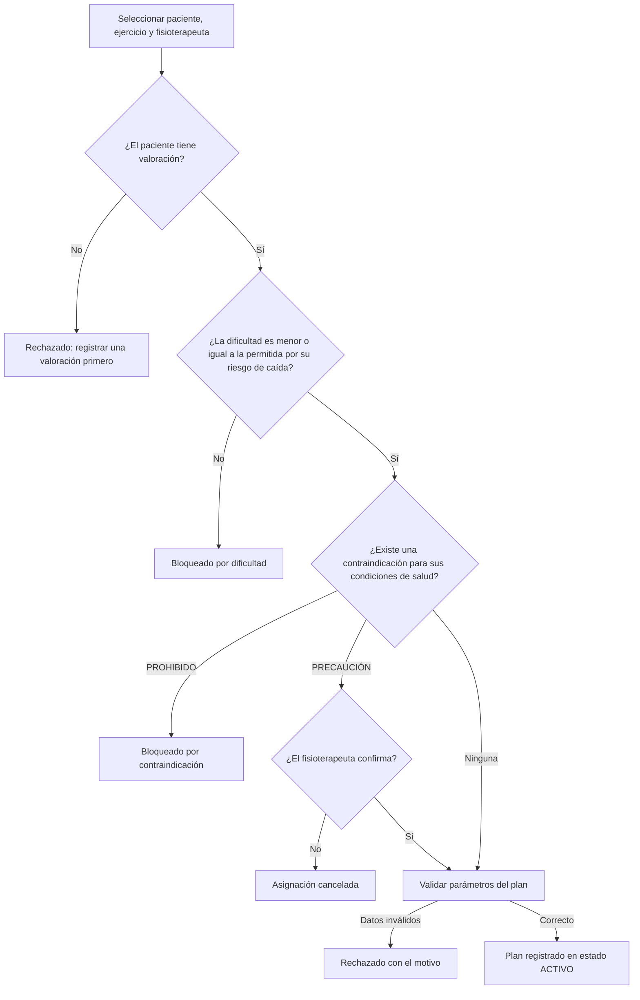
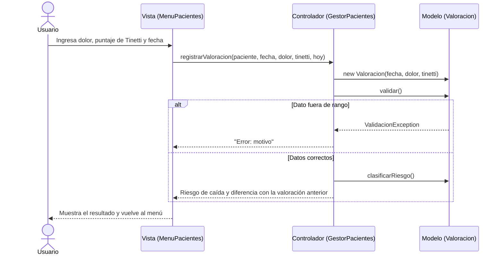
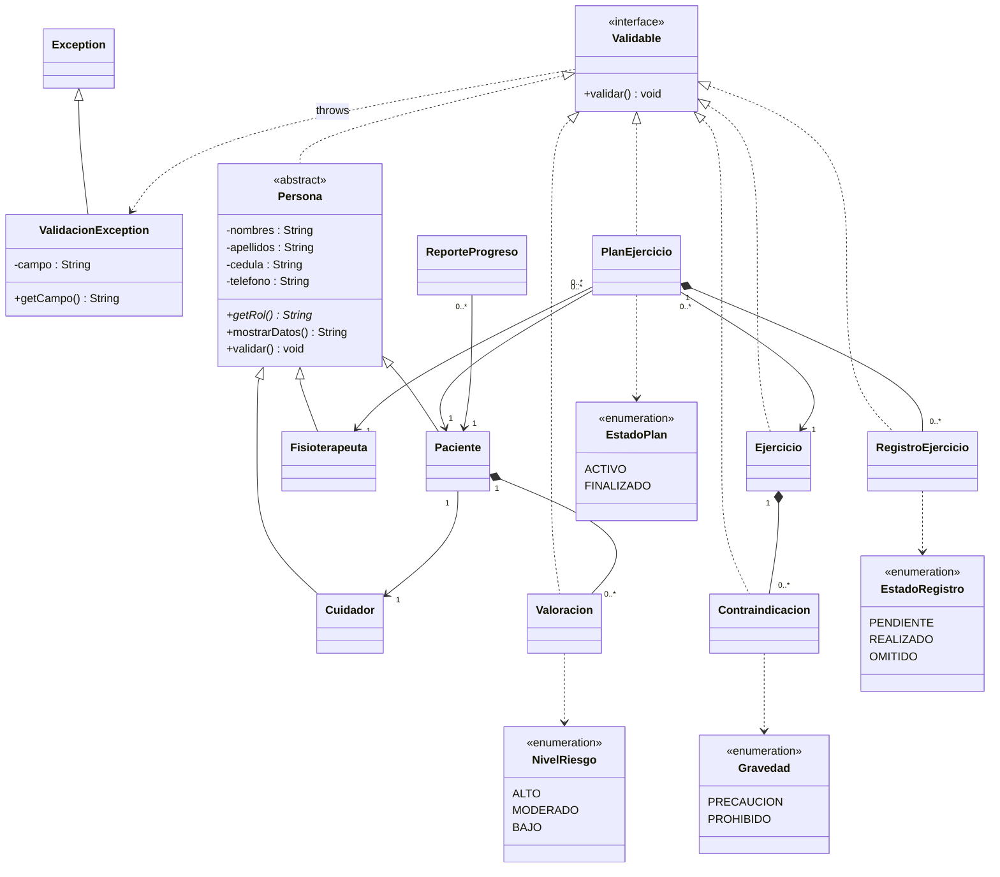
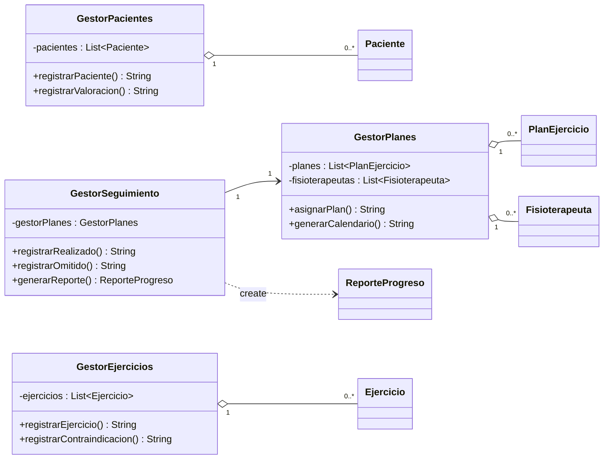
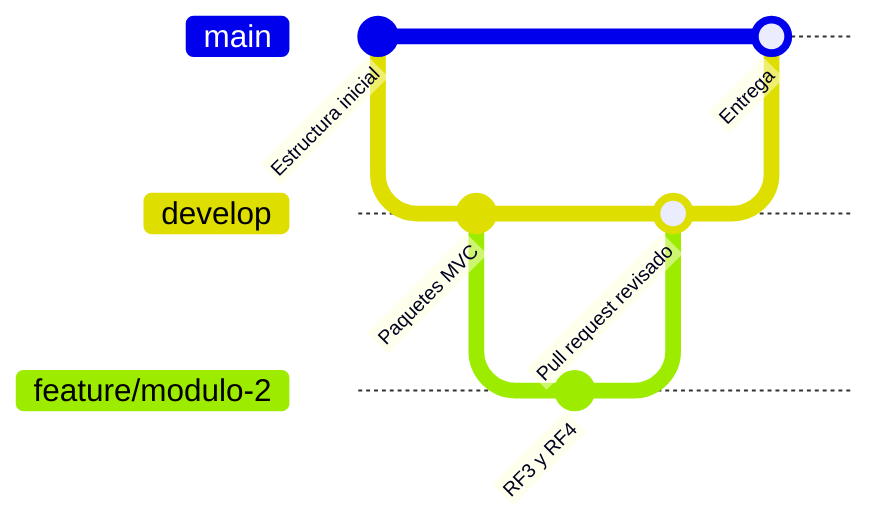

# MNS-REHAB

**Sistema de seguimiento de la rehabilitación fisioterapéutica de adultos mayores**

Aplicación en Java, organizada según el patrón Modelo–Vista–Controlador (MVC), que registra a los pacientes y sus valoraciones, administra un catálogo de ejercicios con contraindicaciones, asigna planes de ejercicio con verificación de seguridad y mide el cumplimiento del tratamiento en casa.

Proyecto académico · Programación II · Universidad de las Américas (UDLA) · Grupo 34

| | |
|---|---|
| **Lenguaje** | Java 17 o superior |
| **Paradigma** | Programación Orientada a Objetos |
| **Arquitectura** | MVC en tres paquetes: `modelo`, `negocio`, `interfaz` |
| **Versión actual** | Avance 2 · interfaz en modo consola |
| **Persistencia** | En memoria (colecciones `List` y `Map`) |
| **Dependencias externas** | Ninguna |

---

## Contenido

1. [Contexto y problema](#1-contexto-y-problema)
2. [Alcance de la solución](#2-alcance-de-la-solución)
3. [Arquitectura](#3-arquitectura)
4. [Flujo de la aplicación](#4-flujo-de-la-aplicación)
5. [Modelo de clases](#5-modelo-de-clases)
6. [Reglas de negocio](#6-reglas-de-negocio)
7. [Estructura del proyecto](#7-estructura-del-proyecto)
8. [Instalación y ejecución](#8-instalación-y-ejecución)
9. [Datos de prueba](#9-datos-de-prueba)
10. [Equipo y forma de trabajo](#10-equipo-y-forma-de-trabajo)
11. [Hoja de ruta](#11-hoja-de-ruta)

---

## 1. Contexto y problema

En Ecuador, el 9 % de la población tiene 65 años o más y cerca del 30 % de ese grupo presenta alguna dificultad funcional, principalmente de movilidad (INEC, 2023; 2024). La fisioterapia es el tratamiento habitual para recuperar el equilibrio y prevenir caídas, pero gran parte de su efecto depende de los ejercicios que el paciente realiza en casa entre sesiones.

Hoy esas indicaciones se entregan en papel o de forma verbal. No queda registro de si el paciente realizó los ejercicios, con cuánto dolor, ni si un ejercicio era adecuado para sus condiciones de salud. El abandono se detecta tarde y el fisioterapeuta ajusta el plan con base en lo que el paciente recuerda.

**MNS-REHAB** ordena esa información para que el fisioterapeuta decida con datos y la familia pueda acompañar el tratamiento.

---

## 2. Alcance de la solución

El sistema se divide en cuatro módulos, uno por integrante. Cada módulo cubre dos requerimientos funcionales (RF) e incluye al menos una regla de negocio.

| Módulo | Responsable | Requerimientos | Qué resuelve |
|---|---|---|---|
| **M1 · Pacientes y valoración** | Ana Sofia Jimenez | RF1 Registrar paciente · RF2 Registrar valoración y clasificar riesgo de caída | Ficha única del paciente y evolución del dolor y del equilibrio (escala de Tinetti) |
| **M2 · Ejercicios y contraindicaciones** | Sneyder Tarco | RF3 Registrar ejercicio · RF4 Registrar contraindicación | Catálogo de ejercicios con las condiciones de salud en que están prohibidos o requieren precaución |
| **M3 · Planes de ejercicio** | Pamela Mantilla | RF5 Asignar plan con verificación de seguridad · RF6 Generar calendario | Asignación segura según el riesgo del paciente y calendario automático de ejercicios |
| **M4 · Seguimiento** | Evelyn Chuquin | RF7 Registrar ejercicio realizado u omitido · RF8 Calcular cumplimiento y generar reporte | Registro diario, alertas de dolor y reporte de cumplimiento del tratamiento |

---

## 3. Arquitectura

La aplicación sigue el patrón **MVC**. Cada capa es un paquete de Java y las dependencias van en un solo sentido: la vista usa al controlador y el controlador usa al modelo. Así, en la versión final la interfaz de consola puede reemplazarse por una interfaz gráfica sin modificar las reglas de negocio ni las entidades.



| Capa | Paquete | Responsabilidad |
|---|---|---|
| Vista | `interfaz` | Solicita los datos por consola, invoca al gestor correspondiente y muestra el resultado. No contiene reglas de negocio. |
| Controlador | `negocio` | Un gestor por módulo. Aplica las reglas de cada requerimiento, administra las colecciones en memoria y captura las excepciones de validación. |
| Modelo | `modelo` | Entidades del problema con encapsulamiento completo. Cada entidad valida sus propios datos a través de la interfaz `Validable`. |

### Principios de Programación Orientada a Objetos aplicados

| Principio | Implementación |
|---|---|
| Encapsulamiento | Todos los atributos son privados; el acceso se realiza mediante métodos `get` y, solo cuando el dato puede cambiar, `set`. |
| Herencia | `Paciente`, `Cuidador` y `Fisioterapeuta` extienden la clase `Persona`. `ValidacionException` extiende `Exception`. |
| Abstracción | `Persona` es una clase abstracta con el método abstracto `getRol()`. |
| Polimorfismo | Las subclases de `Persona` sobrescriben `getRol()`, `mostrarDatos()` y `validar()`. Los gestores invocan `validar()` sin conocer la clase concreta del objeto. |
| Interfaces | `Validable` define el contrato `validar()` para seis entidades del modelo. |
| Manejo de excepciones | `ValidacionException` informa el campo y el motivo del error; los gestores la capturan con `try/catch` y la aplicación nunca se detiene por un dato incorrecto. |

---

## 4. Flujo de la aplicación

### 4.1 Navegación en consola



### 4.2 Verificación de seguridad al asignar un plan (RF5)



### 4.3 Secuencia de una operación entre capas



---

## 5. Modelo de clases

Vista simplificada de las relaciones principales. El diagrama completo, con atributos, constructores, métodos de acceso y multiplicidades, se encuentra en la documentación del proyecto (sección 6) y en el archivo editable de draw.io.



### Gestores (capa de negocio)



---

## 6. Reglas de negocio

| RF | Regla | Comportamiento del sistema |
|---|---|---|
| RF1 | Cédula ecuatoriana válida (10 dígitos, provincia y dígito verificador) y no duplicada | Se rechaza el registro e informa el motivo |
| RF1 | Edad mínima de 65 años y cuidador de contacto obligatorio | Se rechaza el registro e informa el motivo |
| RF2 | Dolor de 0 a 10, Tinetti de 0 a 28 y fecha no futura | Riesgo de caída: ALTO (menos de 19), MODERADO (19 a 24), BAJO (25 o más) |
| RF3 | Dificultad de 1 a 3; sin duplicados por nombre y zona del cuerpo | Se rechaza el registro e informa el motivo |
| RF4 | Una sola contraindicación por pareja ejercicio–condición | Se rechaza el duplicado |
| RF5 | Dificultad máxima según riesgo: ALTO 1, MODERADO 2, BAJO 3 | Un ejercicio de mayor dificultad se bloquea |
| RF5 | Contraindicación PROHIBIDO / PRECAUCIÓN | PROHIBIDO bloquea; PRECAUCIÓN exige confirmación del fisioterapeuta |
| RF6 | El calendario se genera una sola vez por plan | No se duplican registros |
| RF7 | No se registra una fecha futura ni un registro ya cerrado | Se conserva el estado anterior e informa el motivo |
| RF7 | Dolor de 7 o más | Genera una alerta para el fisioterapeuta |
| RF8 | Cumplimiento = realizados ÷ vencidos × 100 | Sin ejercicios vencidos se informa «No aplica»; menos de 80 % genera alerta |

---

## 7. Estructura del proyecto

```text
MNS-REHAB/
└── src/
    ├── modelo/                     Modelo: entidades del dominio
    │   ├── Persona.java              clase abstracta
    │   ├── Validable.java            interfaz
    │   ├── ValidacionException.java  excepción propia
    │   ├── Paciente.java
    │   ├── Cuidador.java
    │   ├── Fisioterapeuta.java
    │   ├── Valoracion.java
    │   ├── Ejercicio.java
    │   ├── Contraindicacion.java
    │   ├── PlanEjercicio.java
    │   ├── RegistroEjercicio.java
    │   ├── ReporteProgreso.java
    │   ├── NivelRiesgo.java          enumeración
    │   ├── Gravedad.java             enumeración
    │   ├── EstadoPlan.java           enumeración
    │   └── EstadoRegistro.java       enumeración
    │
    ├── negocio/                    Controlador: reglas de cada módulo
    │   ├── GestorPacientes.java      M1 · RF1, RF2
    │   ├── GestorEjercicios.java     M2 · RF3, RF4
    │   ├── GestorPlanes.java         M3 · RF5, RF6
    │   └── GestorSeguimiento.java    M4 · RF7, RF8
    │
    └── interfaz/                   Vista: menús de consola
        ├── Main.java                 punto de entrada
        ├── MenuPrincipal.java
        ├── MenuPacientes.java
        ├── MenuEjercicios.java
        ├── MenuPlanes.java
        └── MenuSeguimiento.java
```

---

## 8. Instalación y ejecución

### Requisitos

- JDK 17 o superior
- IntelliJ IDEA (recomendado) o cualquier terminal con `javac`

### Opción A · IntelliJ IDEA

1. `File` → `New` → `Project from Version Control` y pegar la URL del repositorio.
2. Cambiar a la rama `develop`.
3. Verificar en `File` → `Project Structure` → `SDK` que el proyecto use JDK 17 o superior.
4. Abrir `src/interfaz/Main.java` y ejecutar `Run 'Main.main()'`.

### Opción B · Línea de comandos

Desde la raíz del repositorio:

**Windows (PowerShell)**
```powershell
javac -encoding UTF-8 -d out (Get-ChildItem -Recurse src -Filter *.java).FullName
java -cp out interfaz.Main
```

**macOS / Linux**
```bash
javac -encoding UTF-8 -d out $(find src -name "*.java")
java -cp out interfaz.Main
```

Las fechas se ingresan con el formato `aaaa-mm-dd`.

---

## 9. Datos de prueba

Al iniciar, la aplicación carga datos de ejemplo para recorrer todos los módulos sin registrar información previa.

| Tipo | Datos |
|---|---|
| Pacientes | Rosa Elena Guamán Pérez · C.I. 1705123451 · osteoporosis · riesgo MODERADO<br>Luis Alberto Andrade Mora · C.I. 1002456786 · prótesis de cadera · riesgo ALTO |
| Fisioterapeutas | Andrea Salazar Vega · MSP-FT-0457<br>Carlos Mena Ortiz · MSP-FT-0812 |
| Ejercicios | Sentadilla asistida (2) · Elevación de talones (1) · Saltos suaves (3) · Puente de glúteos (1) |
| Contraindicaciones | Saltos suaves – Osteoporosis – PROHIBIDO<br>Sentadilla asistida – Osteoporosis – PRECAUCIÓN<br>Puente de glúteos – Prótesis de cadera – PRECAUCIÓN |
| Plan activo | Rosa · Elevación de talones · 3 × 12 · lunes, miércoles y viernes, con calendario y registros |

**Casos sugeridos para la demostración**

| Caso | Pasos | Resultado esperado |
|---|---|---|
| Bloqueo por dificultad | Módulo 3 → Asignar plan → Rosa → Saltos suaves | Bloqueado: dificultad 3 con riesgo MODERADO |
| Confirmación por precaución | Módulo 3 → Asignar plan → Rosa → Sentadilla asistida | Solicita confirmación del fisioterapeuta |
| Alerta de dolor | Módulo 4 → Registrar realizado → dolor 8 | Registro guardado con alerta |
| Reporte de cumplimiento | Módulo 4 → Reporte → Rosa → últimos 40 días | Cumplimiento por ejercicio y global, variación de dolor y Tinetti |
| Polimorfismo | Menú principal → 5 | Cada persona se muestra con los datos propios de su rol |

---

## 10. Equipo y forma de trabajo

| Integrante | Rol | Módulo |
|---|---|---|
| Evelyn Chuquin | Líder del proyecto | M4 · Seguimiento |
| Ana Sofia Jimenez | Análisis y diseño funcional | M1 · Pacientes y valoración |
| Sneyder Tarco | Análisis de procesos y datos | M2 · Ejercicios y contraindicaciones |
| Pamela Mantilla | Investigación y sustento | M3 · Planes de ejercicio |

**Flujo de ramas**



- `main`: versiones entregadas. Protegida; solo recibe cambios desde `develop`.
- `develop`: integración del trabajo del equipo.
- `feature/<módulo>`: desarrollo de cada integrante; se integra a `develop` mediante pull request.
- Las pruebas se realizan de forma cruzada: cada módulo lo prueba un integrante distinto de su responsable.

---

## 11. Hoja de ruta

| Entrega | Contenido | Estado |
|---|---|---|
| Avance 1 | Definición del problema, requerimientos y planificación | Completado |
| Avance 2 | Diseño UML, arquitectura MVC y sistema en modo consola | En curso |
| Entrega final | Interfaz gráfica, plan de pruebas con evidencias y documentación completa | Planificado |

---

## Referencias

- Instituto Nacional de Estadística y Censos. (2023). *Censo de Población y Vivienda 2022*. https://www.ecuadorencifras.gob.ec/
- Instituto Nacional de Estadística y Censos. (2024). *Desafíos y oportunidades para el Ecuador ante el envejecimiento poblacional*. https://www.ecuadorencifras.gob.ec/
- Oracle. (2023). *Java Platform, Standard Edition documentation*. https://docs.oracle.com/en/java/

---

<sub>Proyecto académico desarrollado para la asignatura Programación II de la Universidad de las Américas. Uso educativo.</sub>
